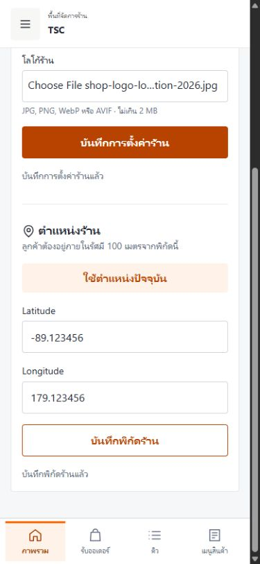
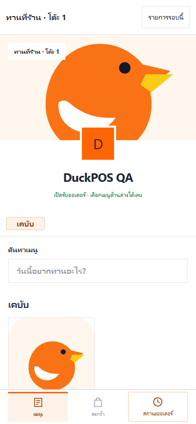
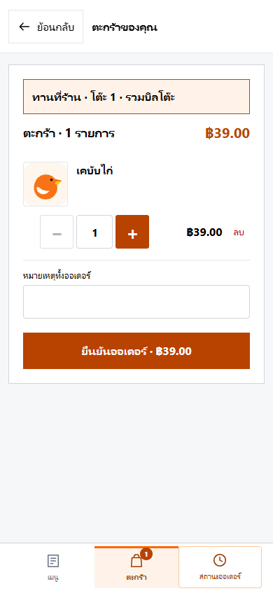
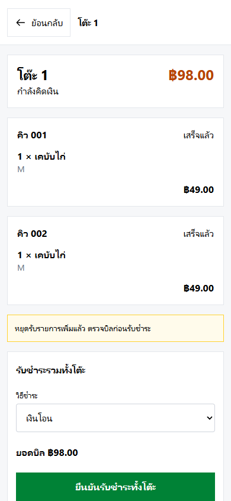
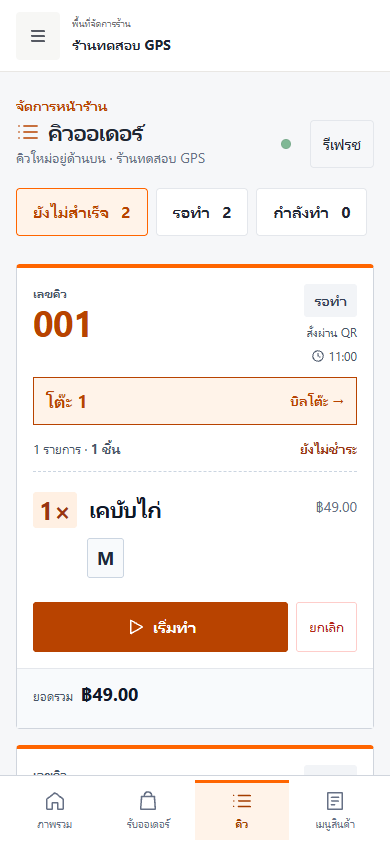
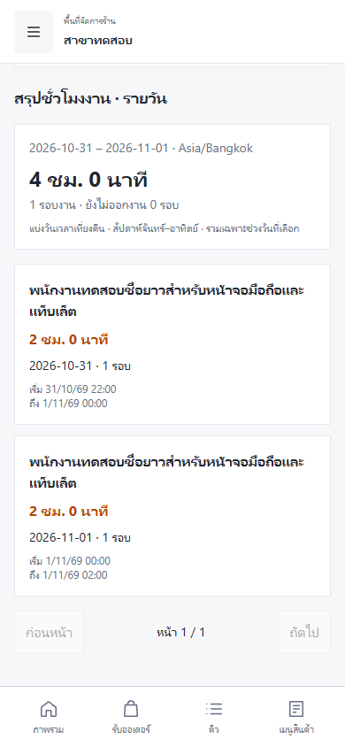
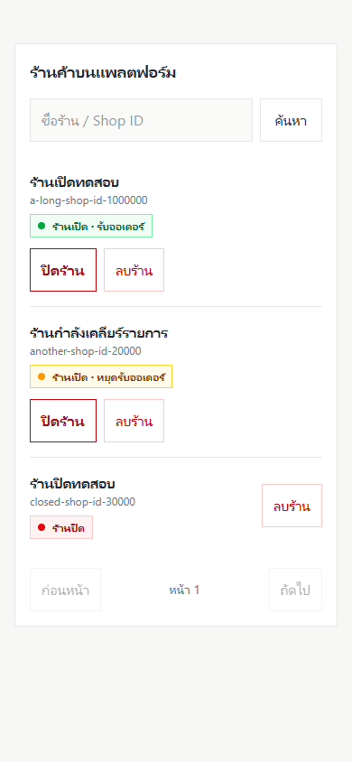
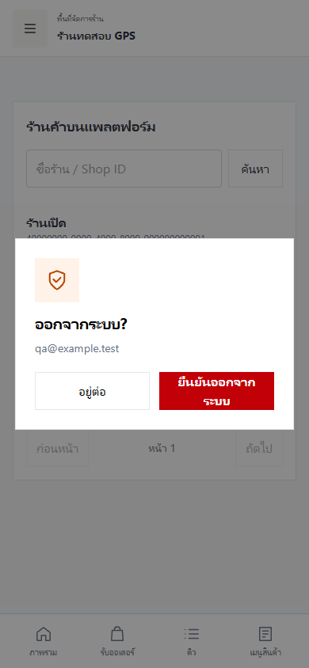
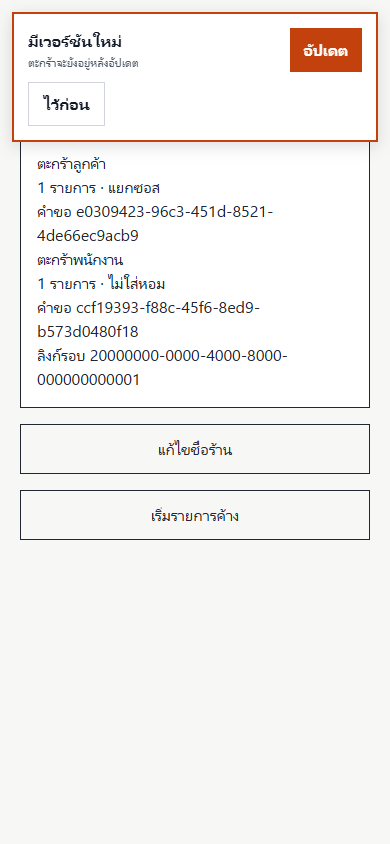

# คู่มือการใช้งาน DuckPOS

คู่มือนี้อธิบายการใช้งานสำหรับผู้ดูแลแพลตฟอร์ม เจ้าของร้าน พนักงาน และลูกค้า โดยเรียงตามงานที่ทำจริง ภาพประกอบเป็น **ข้อมูลจำลองจากการทดสอบ** ชื่อร้าน ราคา และรายการอาหารจึงอาจต่างจากร้านของคุณ

## สารบัญ

1. [สิทธิ์และการเริ่มต้น](#1-สิทธิ์และการเริ่มต้น)
2. [จัดการร้านและสาขา](#2-จัดการร้านและสาขา)
3. [เมนูและท็อปปิง](#3-เมนูและท็อปปิง)
4. [เปิดร้านและหยุดรับออเดอร์](#4-เปิดร้านและหยุดรับออเดอร์)
5. [รับออเดอร์หน้าร้าน](#5-รับออเดอร์หน้าร้าน)
6. [QR หน้าร้านสำหรับสั่งกลับบ้าน](#6-qr-หน้าร้านสำหรับสั่งกลับบ้าน)
7. [QR โต๊ะและบิลรวม](#7-qr-โต๊ะและบิลรวม)
8. [คิวและการรับชำระ](#8-คิวและการรับชำระ)
9. [รายงานและประวัติ](#9-รายงานและประวัติ)
10. [LINE](#10-line)
11. [ลงเวลาและชั่วโมงงาน](#11-ลงเวลาและชั่วโมงงาน)
12. [จัดการแพลตฟอร์ม](#12-จัดการแพลตฟอร์ม)
13. [โปรไฟล์ ออกจากระบบ และอัปเดต](#13-โปรไฟล์-ออกจากระบบ-และอัปเดต)
14. [ปัญหาที่พบบ่อย](#14-ปัญหาที่พบบ่อย)

## 1. สิทธิ์และการเริ่มต้น

| ผู้ใช้ | งานหลัก |
|---|---|
| ผู้ดูแลแพลตฟอร์ม | อนุมัติสิทธิ์สร้างร้าน ดูสถานะร้าน และจัดการร้านบนแพลตฟอร์ม |
| เจ้าของร้าน | ตั้งค่าร้าน สร้างเมนู จัดการพนักงาน ดูรายงานและตั้งค่า LINE รวมถึงทำงานหน้าร้าน |
| พนักงาน | เปิด–ปิดรอบขาย รับออเดอร์ จัดการคิว รับชำระ และลงเวลา ตามสิทธิ์ของร้าน |
| ลูกค้า | สแกน QR เลือกอาหาร ส่งออเดอร์ และติดตามสถานะ โดยไม่ต้องเข้าสู่ระบบ |

### Flow: ขอสิทธิ์สร้างร้าน

1. เข้าสู่ระบบด้วย Google แล้วคัดลอก **User ID** จากหน้าบัญชีหรือหน้ารออนุมัติ
2. ส่ง User ID ให้ผู้ดูแลแพลตฟอร์มด้วยช่องทางที่ตกลงกัน
3. ผู้ดูแลกรอก ID ในหน้าจัดการแพลตฟอร์มและอนุมัติสิทธิ์สร้างร้าน
4. กลับเข้าแอป สร้างร้าน ตั้งชื่อและข้อมูลร้าน จากนั้นเพิ่มเมนู
5. เจ้าของร้านนำ User ID ของพนักงานที่เคยเข้าสู่ระบบแล้วมาเพิ่มในเมนู **พนักงานและสิทธิ์**

## 2. จัดการร้านและสาขา

### Flow: ตั้งค่าร้าน

1. เลือกร้านจาก **สาขาของคุณ** ในเมนูด้านข้าง แล้วไปที่ **ข้อมูลร้าน**
2. แก้ชื่อร้านหรือเลือกไฟล์โลโก้ กด **บันทึกการตั้งค่าร้าน**
3. ตั้งพิกัดด้วยการกรอก Latitude/Longitude หรือกดใช้ตำแหน่งปัจจุบัน แล้วบันทึกพิกัด
4. ตรวจสอบตำแหน่งก่อนใช้งานจริง: QR หน้าร้านใช้รัศมี 100 เมตรจากพิกัดร้าน ส่วน QR โต๊ะไม่จำกัดรัศมี

บัญชีหนึ่งมีหลายร้านหรือสาขาได้ หากต้องการเพิ่มสาขาให้ใช้เมนู **เพิ่มสาขา** ตามสิทธิ์บัญชี เมื่อต้องการสลับสาขา เลือกสาขาในเมนูด้านข้างและยืนยันชื่อสาขาก่อนทำรายการต่อ

### Flow: เพิ่มหรือถอนสิทธิ์พนักงาน

1. ให้พนักงานเข้าสู่ระบบ Google อย่างน้อยหนึ่งครั้งและส่ง User ID ให้เจ้าของร้าน
2. เจ้าของร้านเลือกสาขาที่ถูกต้อง เปิด **พนักงานและสิทธิ์** แล้วกรอก User ID
3. เลือกบทบาทและกดเพิ่ม/อัปเดต ตรวจสอบรายชื่อหลังบันทึก
4. เมื่อต้องการยกเลิกสิทธิ์ ให้เลือกสมาชิกและถอนสิทธิ์ ระบบป้องกันการถอนสิทธิ์ของตนเอง

## 3. เมนูและท็อปปิง

### Flow: เพิ่มหมวดหมู่และเมนู

1. เปิด **เมนูสินค้า** กดเพิ่มหมวดหมู่ ตั้งชื่อ แล้วบันทึก
2. กด **เพิ่มเมนู** เลือกหมวดหมู่ กรอกชื่อ ราคา รายละเอียด และเลือกรูปถ้ามี
3. เลือกการแสดงผลและสถานะพร้อมขาย แล้วบันทึก
4. ใช้เมนูสามจุดบนรายการเพื่อแก้ไขหรือลบ และใช้ปุ่มปิดขายสินค้าเมื่อต้องการหยุดขายชั่วคราว

### Flow: ตั้งกลุ่มท็อปปิงใช้ร่วมกัน

1. ไปที่ **ท็อปปิง** กดสร้างกลุ่ม เช่น ขนาด หรือซอส
2. เลือก **เลือกได้อันเดียว** หรือ **เลือกได้หลายอัน** และกำหนดว่าจำเป็นต้องเลือกหรือไม่
3. เลือกวิธีคิดราคา เช่น ราคาของแต่ละรายการ หรือรายการแรกฟรีและรายการถัดไปราคาเท่ากัน
4. เลือกหมวดหมู่เมนูที่ใช้กลุ่มนี้ แล้วบันทึก
5. เพิ่มรายการในกลุ่ม เช่น S/M/L หรือชื่อซอส พร้อมราคา ตรวจสอบความพร้อมขายของแต่ละรายการ

ตัวอย่างซอสแรกฟรี: เลือกหลายอัน ตั้งวิธีคิดราคาเป็นรายการแรกฟรี แล้วกำหนดราคาของรายการถัดไป ระบบคำนวณยอดตอนส่งออเดอร์จากข้อมูลที่ร้านตั้งไว้

## 4. เปิดร้านและหยุดรับออเดอร์

### Flow: เริ่มและจบรอบขาย

1. ที่ **ภาพรวม** ตรวจสอบสถานะร้าน แล้วรูดเพื่อเปิดร้าน หรือเปิดจากหน้า **รอบการขาย**
2. เจ้าของร้านและพนักงานเปิด–ปิดรอบขายได้
3. หากต้องหยุดรับลูกค้าใหม่แต่ยังมีงานค้าง ให้กด **หยุดรับออเดอร์ใหม่/หยุดรับชั่วคราว** พนักงานยังจัดการคิวเดิมและรับชำระได้
4. ทำอาหารและรับชำระค้างให้ครบ ปิดบิลโต๊ะที่ยังเปิด แล้วจึงปิดรอบขาย
5. หากระบบแจ้งรายการค้าง ให้ไปที่ **คิวออเดอร์** หรือ **โต๊ะและบิล** ตามข้อความ แล้วกลับมาปิดรอบอีกครั้ง

การหยุดรับชั่วคราวกับการปิดรอบขายเป็นคนละขั้นตอน: ขณะหยุดรับ ร้านยังมีรอบขายเปิดอยู่เพื่อเคลียร์งาน

## 5. รับออเดอร์หน้าร้าน

1. เปิด **ขายหน้าร้าน / รับออเดอร์** ตรวจว่าร้านเปิดรับออเดอร์
2. ค้นหาสินค้าหรือเลือกหมวดหมู่ รวมถึง **ทุกหมวดหมู่**
3. แตะสินค้า เลือกขนาดหรือท็อปปิง ระบุจำนวนและหมายเหตุ แล้วเพิ่มลงตะกร้า
4. กดแถบตะกร้าด้านล่าง ตรวจรูปสินค้า รายการ จำนวน และยอดรวม
5. ยืนยันสร้างออเดอร์และรับเลขคิว จากนั้นไปที่ **คิวออเดอร์** เพื่อจัดเตรียมและรับชำระ

## 6. QR หน้าร้านสำหรับสั่งกลับบ้าน

### Flow: เจ้าของร้านเตรียม QR

1. ไปที่ **QR สั่งอาหาร** ตรวจสอบร้านหรือสาขา
2. เปิดหรือดาวน์โหลด QR แล้วนำไปแสดงหน้าร้าน
3. ตั้งพิกัดร้านให้ถูกต้อง เพราะระบบตรวจระยะ 100 เมตรเมื่อส่งออเดอร์จาก QR หน้าร้าน

### Flow: ลูกค้าสั่งและติดตาม

1. สแกน QR หน้าร้าน เลือกเมนูและตัวเลือก แล้วเพิ่มลงตะกร้า
2. ตรวจจำนวน หมายเหตุ และราคา กด **ยืนยันออเดอร์**
3. อนุญาตตำแหน่งเมื่อเบราว์เซอร์ขอ และอยู่ภายในรัศมีร้านขณะส่งออเดอร์
4. ดูเลขคิวและสถานะจากหน้าติดตาม สลับกลับไปดูเมนูได้จากเมนูด้านล่าง
5. หากรายการยังไม่เริ่มทำ สามารถใช้ปุ่มยกเลิกในหน้าติดตามตามเงื่อนไขของระบบ เมื่อเริ่มทำแล้วให้ติดต่อพนักงาน

## 7. QR โต๊ะและบิลรวม

### Flow: เตรียมโต๊ะ

1. เจ้าของร้านเปิด **โต๊ะและบิล** กด **เพิ่มโต๊ะ** ตั้งชื่อ เช่น โต๊ะ 1 แล้วบันทึก
2. กดปุ่ม QR บนการ์ดโต๊ะ ดาวน์โหลดและนำ QR ของโต๊ะนั้นไปวางบนโต๊ะ
3. เมื่อรอบขายเปิด โต๊ะพร้อมให้ลูกค้าสแกน ไม่ต้องเปิดบิลก่อน ลูกค้าส่งออเดอร์แรกแล้วระบบสร้างบิลให้อัตโนมัติ

### Flow: ลูกค้าสั่งหลายรอบ

1. สแกน QR ที่โต๊ะ หน้าจอแสดงชื่อร้านและโต๊ะ เลือกอาหารได้ทันที โดยไม่ต้องเปิด GPS
2. เลือกตัวเลือกและจำนวน กดเพิ่มลงตะกร้า แล้วกดดูตะกร้าเพื่อตรวจรายการ
3. กดยืนยัน ออเดอร์และเลขคิวจะปรากฏในหน้าติดตามและคิวพนักงาน
4. หากต้องการเพิ่มอาหาร กด **สั่งเพิ่มในรอบนี้** แล้วส่งรายการใหม่ ระบบรวมเข้าโต๊ะและบิลเดิม
5. ลูกค้าแต่ละเครื่องดูรายการที่เครื่องนั้นสั่ง ส่วนพนักงานดูยอดรวมทั้งโต๊ะได้

### Flow: พนักงานคิดเงินทั้งโต๊ะ

1. ไปที่ **โต๊ะและบิล** เลือก **ดูรายการ / บิล** ของโต๊ะ หรือกดลิงก์บิลโต๊ะจากคิว
2. ตรวจรายการทุกคิวและยอดรวม กด **คิดเงิน / หยุดรับรายการ** เพื่อหยุดเพิ่มรายการระหว่างตรวจบิล
3. เลือกเงินโอนหรือเงินสด หากเป็นเงินสดกรอกยอดรับ แล้วตรวจเงินทอน
4. กด **ยืนยันรับชำระทั้งโต๊ะ** หนึ่งครั้ง ระบบบันทึกการรับชำระรวม
5. เมื่อชำระและอาหารเสร็จครบ โต๊ะจะพร้อมรับลูกค้ารอบใหม่ หากชำระก่อนอาหารครบ ให้พนักงานทำคิวที่เหลือจนเสร็จ

### กลับมาดูรอบเดิม

ลิงก์ติดตามที่เคยเปิดก่อนจ่ายยังแสดงรอบเดิมและข้อความชำระเสร็จเมื่อกลับมาเปิดอีกครั้ง รอบที่ชำระแล้วไม่สามารถสั่งเพิ่มหรือเริ่มรอบใหม่จากหน้าติดตามได้ หากต้องการสั่งอีก ให้สแกน QR โต๊ะอีกครั้ง เมื่อโต๊ะพร้อมระบบจะเปิดเมนูสำหรับรอบใหม่

ข้อมูลที่จำไว้ผูกกับเบราว์เซอร์และโดเมนเดิม หากล้างข้อมูลเว็บ ใช้โหมดส่วนตัว หรือเปลี่ยนเครื่อง อาจไม่พบรอบที่จำไว้ ควรเก็บลิงก์ติดตามไว้หากต้องกลับมาดูจากเครื่องอื่น

## 8. คิวและการรับชำระ

### Flow: ทำอาหาร

1. เปิด **คิวออเดอร์** ค่าเริ่มต้นคือ **ยังไม่สำเร็จ**
2. ตรวจเลขคิว ชื่อสินค้า จำนวน ขนาด/ซอส และหมายเหตุ ถ้ามาจากโต๊ะจะมีชื่อโต๊ะและลิงก์บิล
3. กด **เริ่มทำ** เมื่อเริ่มเตรียมอาหาร แล้วกด **เสร็จแล้ว** เมื่อเสร็จ
4. คิวที่ทำเสร็จแต่ยังไม่ชำระยังอยู่ในกลุ่มยังไม่สำเร็จ เมื่ออาหารเสร็จและชำระครบจึงออกจากกลุ่มนี้
5. ใช้ตัวกรองรอทำ กำลังทำ พร้อมรับ หรือรอรับชำระ เพื่อดูงานเฉพาะสถานะ

จุดสถานะ Realtime ช่วยแสดงการเชื่อมต่อ หากข้อมูลยังไม่อัปเดต ให้ตรวจอินเทอร์เน็ตและกด **รีเฟรช**

### Flow: รับชำระ

- **หน้าร้านและ QR หน้าร้าน:** เปิดส่วนรับชำระบนคิว เลือกเงินโอนหรือเงินสด ตรวจยอดรับ แล้วกดยืนยัน พนักงานบันทึกการชำระด้วยตนเอง ระบบไม่ได้ตรวจสลิปหรือเชื่อม payment gateway
- **QR โต๊ะ:** ไปที่บิลโต๊ะและรับชำระรวม ไม่รับเงินแยกในบัตรคิวแต่ละใบ

## 9. รายงานและประวัติ

1. เจ้าของร้านเปิด **รายงานยอดขาย** เลือกช่วงวันที่ที่ต้องการ
2. ตรวจยอดขายและยอดรับชำระ แยกวิธีชำระ และใช้ตัวกรอง/ค้นหาในประวัติ
3. หากต้องใช้ข้อมูลภายนอก ให้ใช้ปุ่มส่งออก CSV ในหน้ารายงาน
4. การลบประวัติขายทำได้ตามสิทธิ์เจ้าของร้าน ทั้งเลือกช่วงวันหรือเลือกรายออร์เดอร์ ควรตรวจรายการและข้อความยืนยันก่อนลบ เพราะยอดรายงานจะลดลงตามข้อมูลที่ลบจริง

รายงานแสดงยอดขายและการรับชำระ ไม่ได้คำนวณต้นทุนหรือกำไร

## 10. LINE

1. เจ้าของร้านเปิด **แจ้งเตือน LINE** กดลิงก์ LINE OA และเพิ่มเพื่อน
2. คัดลอก **Shop ID** ที่แสดงในหน้า แล้วส่งไปยังแชท LINE OA
3. กลับมาที่แอป ตรวจรายชื่อผู้ขอรับรายงาน แล้วอนุมัติผู้รับ
4. ตั้งค่ารายงาน/การแจ้งเตือนที่ต้องการ แล้วบันทึก
5. ตรวจประวัติการส่งและสถานะเมื่อรายงานไม่เข้า และใช้ปุ่มลบประวัติเมื่อจำเป็น

Shop ID ใช้ระบุร้าน ผู้รับต้องได้รับอนุมัติก่อนจึงรับรายงานได้

## 11. ลงเวลาและชั่วโมงงาน

### Flow: พนักงานลงเวลา

1. เลือกร้านที่ถูกต้อง เปิดเมนู **ลงเวลาและชั่วโมงงาน**
2. ขณะอยู่ใกล้ร้าน กดลงเวลาเข้างานและอนุญาตการเข้าถึงตำแหน่งเมื่อระบบขอ
3. เมื่อเลิกงาน กดลงเวลาออกงาน ตรวจผลที่แสดง
4. หากลงเวลาไม่สำเร็จ ให้ตรวจสิทธิ์ตำแหน่งและพิกัดร้าน แล้วลองใหม่

### Flow: ตรวจรายงาน

เปิดส่วนรายงานชั่วโมงงาน เลือกมุมมองรายวัน รายสัปดาห์ หรือรายเดือน และช่วงเวลาที่ต้องการ ตรวจข้อมูลตามพนักงานแต่ละคน เวลาทำงานมาจากการลงเวลาเข้า–ออก ไม่ใช่การนำเวลาที่ร้านเปิดมาหารให้พนักงาน

## 12. จัดการแพลตฟอร์ม

ผู้ดูแลแพลตฟอร์มเปิดเมนู **ผู้ดูแลระบบ** เพื่ออนุมัติสิทธิ์สร้างร้านและค้นหาร้านด้วยชื่อหรือ Shop ID

สถานะร้านแสดง **เขียว** เมื่อเปิดรับออเดอร์ **เหลือง** เมื่อหยุดรับชั่วคราว และ **แดง** เมื่อปิดร้าน ผู้ดูแลกด **ปิดร้าน** และยืนยันปิดรอบขายได้ หากมีคิว ยอดชำระ หรือโต๊ะค้าง สามารถเลือกหยุดรับออเดอร์ใหม่และให้พนักงานเคลียร์รายการก่อน

การลบร้านเป็นการจัดการแยกจากปิดรอบขาย อ่านข้อความยืนยันและพิมพ์ชื่อร้านให้ตรงก่อนดำเนินการ

## 13. โปรไฟล์ ออกจากระบบ และอัปเดต

### โปรไฟล์และออกจากระบบ

กดบัญชีในเมนูด้านข้างเพื่อดูอีเมลที่เข้าสู่ระบบ ผู้ให้บริการ Google และ User ID รวมถึงแก้ชื่อแสดงผล เมื่อกด **ออกจากระบบ** ระบบจะแสดงหน้าต่างยืนยัน กด **อยู่ต่อ** เพื่อยกเลิก หรือ **ยืนยันออกจากระบบ** เพื่อออก

### อัปเดตเวอร์ชัน

เมื่อมีเวอร์ชันใหม่ ระบบแสดง **มีเวอร์ชันใหม่** ให้กด **อัปเดต** หรือ **ไว้ก่อน** ตะกร้าและหมายเหตุในแท็บปัจจุบันจะถูกเก็บก่อนโหลดใหม่ หากกำลังส่งออเดอร์ บันทึกข้อมูล เปิดหน้าต่างทำรายการ หรือแก้ฟอร์มค้าง ให้ทำรายการให้เสร็จและออกจากฟอร์มก่อน

สำหรับการติดตั้งรุ่นแรกที่เริ่มมีระบบแจ้งอัปเดต ให้ทำรายการที่ค้างจากรุ่นเก่าให้เสร็จ แล้วรีโหลดแบบข้าม cache ในแท็บเดิมหนึ่งครั้ง

## 14. ปัญหาที่พบบ่อย

| อาการ | วิธีตรวจสอบ |
|---|---|
| เข้าระบบแล้วไม่มีร้าน | ตรวจว่าเจ้าของร้านเพิ่ม User ID ที่ถูกต้องและอนุมัติสิทธิ์แล้ว จากนั้นเข้าสู่ระบบด้วยบัญชีเดียวกัน |
| ลูกค้าส่ง QR หน้าร้านไม่ได้ | ตรวจว่าร้านเปิดรับออเดอร์ อนุญาตตำแหน่ง พิกัดร้านถูกต้อง และลูกค้าอยู่ในรัศมี 100 เมตร |
| QR โต๊ะส่งไม่ได้ | ตรวจสาขาและสถานะเปิดรับออเดอร์ ตรวจว่าบิลไม่ได้อยู่ระหว่างคิดเงินหรือจบรอบ หากรอบเปลี่ยนให้สแกนและเริ่มรอบใหม่ |
| ปิดร้านไม่ได้ | ตรวจคิวที่ยังทำไม่เสร็จ ยอดค้างชำระ และโต๊ะที่ยังเปิดอยู่ ระหว่างนั้นหยุดรับออเดอร์ใหม่ได้ |
| จ่ายแล้วโต๊ะยังไม่ว่าง | ตรวจว่ามีอาหารในบิลที่ยังไม่ทำเสร็จหรือไม่ เมื่อรายการสุดท้ายเสร็จโต๊ะจะพร้อมรอบใหม่ |
| รายงาน LINE ไม่เข้า | ตรวจการเป็นเพื่อน LINE OA, Shop ID, การอนุมัติผู้รับ การตั้งค่า และประวัติการส่ง |
| ไม่เห็นสถานะร้านหรือเวอร์ชันใหม่ | ตรวจว่า frontend รุ่นล่าสุดถูก deploy แล้ว ทำรายการค้างให้เสร็จและรีโหลดแท็บเดิมแบบข้าม cache หากยังมีปัญหาให้ตรวจเครือข่าย |

รายละเอียดเทคนิคและการทดสอบเพิ่มเติม: [โต๊ะและบิลรวม](DINING_TABLES.md), [แจ้งอัปเดต](APP_UPDATES.md), [ลงเวลา](STAFF_ATTENDANCE.md)
